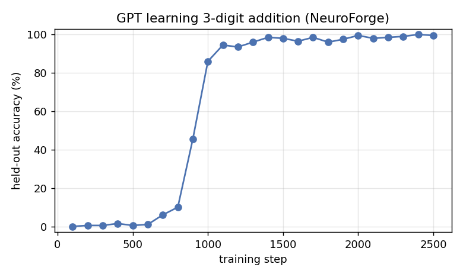
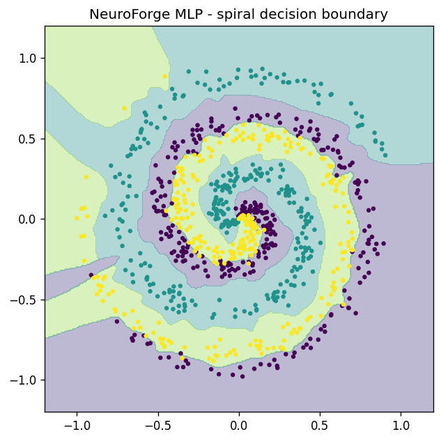

<div align="center">

# NeuroForge

**A deep learning framework built from scratch in pure NumPy.**

Reverse-mode autograd · neural network layers · Adam/AdamW · a GPT transformer · byte-level BPE · a live training dashboard

[](https://github.com/chiragparamesh/neuroforge/actions/workflows/ci.yml)


</div>

---

PyTorch and TensorFlow hide everything behind `loss.backward()`. NeuroForge is what happens when you refuse to accept that as magic and rebuild the whole stack yourself: every gradient, every layer, every optimiser, and a GPT that actually learns, with **no dependency other than NumPy**.

```python
import neuroforge as nf
from neuroforge import nn, optim

x = nf.randn(32, 10, requires_grad=True)
model = nn.Sequential(nn.Linear(10, 64), nn.GELU(), nn.Linear(64, 1))
opt = optim.AdamW(model.parameters(), lr=1e-3)

loss = ((model(x) - 1.0) ** 2).mean()
loss.backward()          # reverse-mode autodiff through the whole graph
opt.step()               # AdamW with decoupled weight decay
```

## What it can do

| Demo | Command | Result |
|---|---|---|
| **GPT learns to add 3-digit numbers** from raw text like `482+017=0499;` | `python examples/train_arithmetic_gpt.py --dashboard` | **99.6 %** held-out accuracy, 102 K params, 2 500 steps |
| **CNN classifies shapes** (circle / square / triangle) | `python examples/train_cnn_shapes.py` | **100 %** test accuracy in 4 epochs |
| **MLP on the 3-arm spiral** | `python examples/train_mlp_spiral.py` | **97.8 %** accuracy + decision boundary |
| **Character / BPE GPT on any text** (e.g. Shakespeare) | `python examples/train_text_gpt.py --data data/shakespeare.txt --dashboard` | coherent samples after a few thousand steps |

<p align="center">
  
  
</p>

The addition task is a nice one: the model sees nothing but strings, and accuracy sits near zero for ~800 steps before it suddenly *groks* place value and carrying, climbing to ~100 % within the next few hundred steps.

### Live dashboard

Add `--dashboard` to any example and a zero-dependency web UI (Python's `http.server` + vanilla JS) opens at `http://127.0.0.1:8787` with:

* live train / validation loss curves (log scale, smoothed), learning rate, gradient norm, accuracy and throughput
* a **generation playground** to prompt the model while it is still training
* **attention heatmaps** for every layer and head of the transformer
* samples logged during training

## Installation

```bash
git clone https://github.com/chiragparamesh/neuroforge.git
cd neuroforge
pip install -e ".[dev]"      # numpy + pytest
neuroforge info              # prints versions and runs a self-test
pytest                       # 96 tests, ~1 minute
```

## Architecture

```
neuroforge/
├── tensor.py          Tensor + reverse-mode autograd (40+ differentiable ops, broadcasting, no_grad, graph export)
├── functional.py      losses, layer_norm, conv2d / max_pool2d via im2col, scaled-dot-product attention
├── nn/
│   ├── module.py      Module base class: parameter discovery, state_dict, train/eval
│   ├── layers.py      Linear, Embedding, LayerNorm, BatchNorm1d, Dropout, Conv2d, MaxPool2d, MLP, ...
│   └── transformer.py GPTConfig, CausalSelfAttention, TransformerBlock, GPT (+ sampling with top-k)
├── optim.py           SGD (momentum/Nesterov), Adam, AdamW, RMSprop, grad clipping, cosine-warmup / step / one-cycle schedulers
├── data/              CharTokenizer, byte-level BPETokenizer, TextDataset, DataLoader, synthetic datasets
├── dashboard/         live training dashboard (server.py + static/index.html)
├── utils.py           gradcheck, checkpoint save/load (.npz), progress bar
└── cli.py             `neuroforge info` / `neuroforge bench`
examples/              arithmetic GPT, text GPT, CNN, MLP, autograd tour, sampling from checkpoints
tests/                 96 tests: finite-difference gradient checks for every op, layer, loss and the transformer
```

### How the autograd engine works

Every operation returns a new `Tensor` that remembers its parents and a closure that knows how to push a gradient back to them:

```python
def __mul__(self, other):
    out = self._make(self.data * other.data, (self, other), "mul")

    def _backward():
        if self.requires_grad:
            self._accumulate(_unbroadcast(out.grad * other.data, self.shape))
        if other.requires_grad:
            other._accumulate(_unbroadcast(out.grad * self.data, other.shape))

    out._backward = _backward
    return out
```

`backward()` does an iterative depth-first topological sort (so graphs thousands of nodes deep do not blow the recursion limit) and calls each node's `_backward` in reverse order. `_unbroadcast` sums gradients back down to the operand's shape, which is what makes NumPy broadcasting "just work" inside the graph.

Every op is verified against central finite differences in float64 (`nf.gradcheck`), including the tricky ones: `softmax`, `log_softmax`, `max` with ties, fancy indexing (scatter-add backward), `conv2d`, `max_pool2d`, causal attention and cross-entropy with label smoothing.

### The transformer

`neuroforge.nn.GPT` is a faithful GPT-2 style decoder: token + learned positional embeddings, pre-LayerNorm blocks with causal multi-head self-attention and a GELU MLP, tied input/output embeddings, residual-projection scaling by 1/√(2·n_layer), AdamW with cosine warm-up decay, gradient clipping, and top-k / temperature sampling. The attention weights of the last forward pass are kept so the dashboard can draw them.

### Performance notes (what I learned)

Pure NumPy will never match a GPU, but a few things made a 4x difference on a laptop CPU:

* **`np.matmul` silently skips BLAS** when the inner 2-D matrices are not C- or F-contiguous (transposed attention heads trip this). `tensor._blas_ready` copies such views to contiguous memory before every matmul.
* **Batched `(B, T, K) @ (K, N)` is ~20x slower** than flattening to a single `(B·T, K) @ (K, N)` GEMM. Every `Linear` layer hits this case; `tensor._matmul` routes through the flattened path, and the weight gradient is computed with one big GEMM instead of a batched product followed by a reduction.
* Convolution uses `as_strided` im2col so the whole conv is one matmul; the backward pass is a col2im scatter.

`neuroforge bench` prints matmul / conv / GPT step timings on your machine.

## Using the pieces

```python
import numpy as np
import neuroforge as nf
from neuroforge.nn import GPT, GPTConfig
from neuroforge.data import BPETokenizer, TextDataset
from neuroforge.optim import AdamW, CosineWarmup, clip_grad_norm_

text = open("data/shakespeare.txt").read()
tok = BPETokenizer().train(text, vocab_size=512)
ds = TextDataset(tok.encode(text), block_size=64)

model = GPT(GPTConfig(vocab_size=tok.vocab_size, block_size=64, n_layer=4, n_head=4, n_embd=128))
opt = AdamW(model.parameters(), lr=1e-3)
sched = CosineWarmup(opt, warmup_steps=100, total_steps=3000)

for step in range(3000):
    x, y = ds.get_batch(32)
    _, loss = model(x, y)
    opt.zero_grad(); loss.backward()
    clip_grad_norm_(model.parameters(), 1.0)
    opt.step(); sched.step()

print(tok.decode(model.generate(np.array([tok.encode("ROMEO:")]), 200, temperature=0.8, top_k=40)[0]))
nf.save_checkpoint("checkpoints/gpt.npz", model, opt)
```

## Roadmap

* KV-cache for faster generation
* Mixed-precision (bfloat16 emulation) and gradient accumulation
* `Conv2d` groups / dilation, `ConvTranspose2d`
* A tiny vision transformer example

## Author

Built by **Chirag** ([@chiragparamesh](https://github.com/chiragparamesh)), final-year AI & ML student at VTU, as a from-first-principles study of how modern deep learning frameworks and language models work. MIT licensed.
